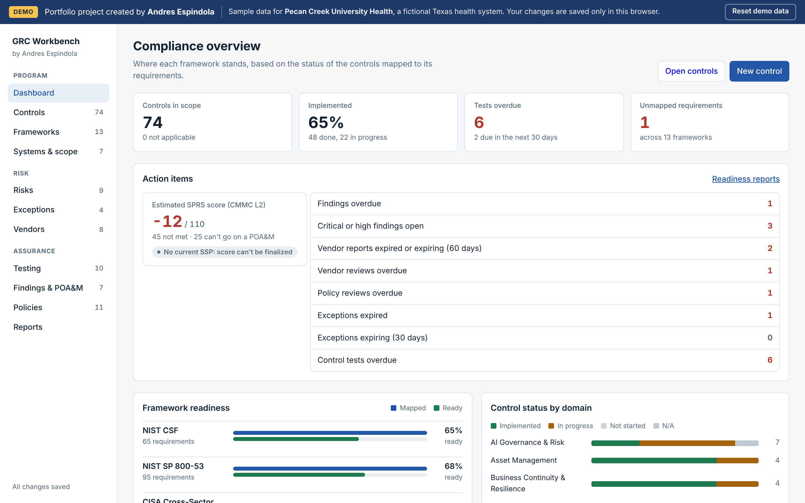
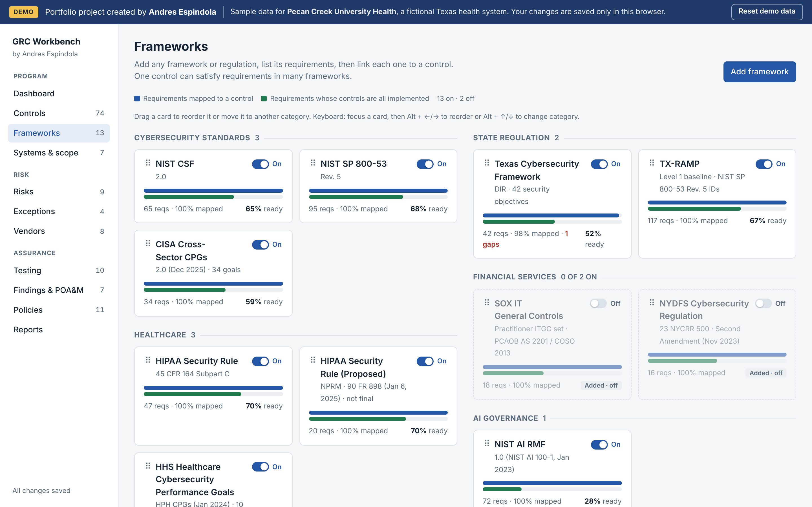
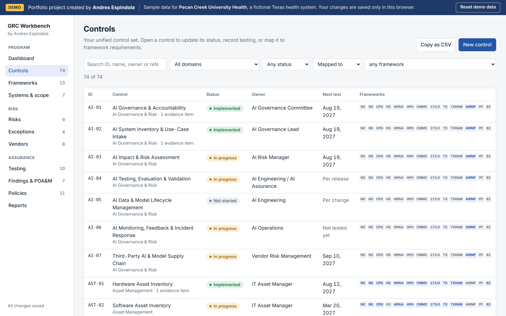
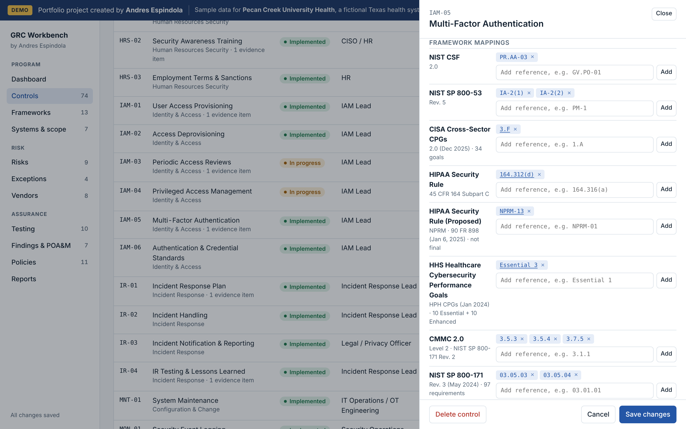
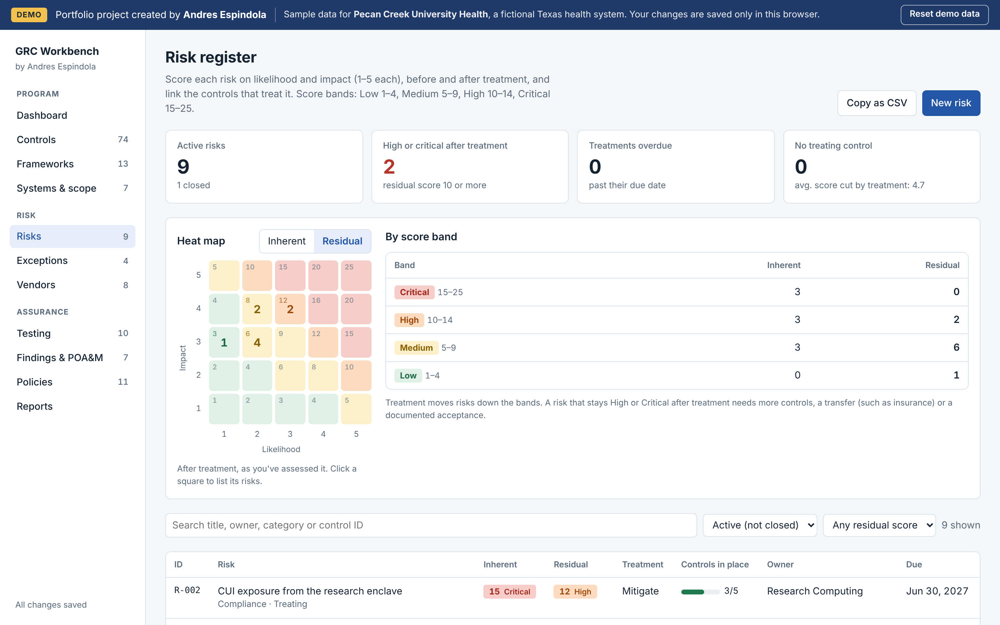
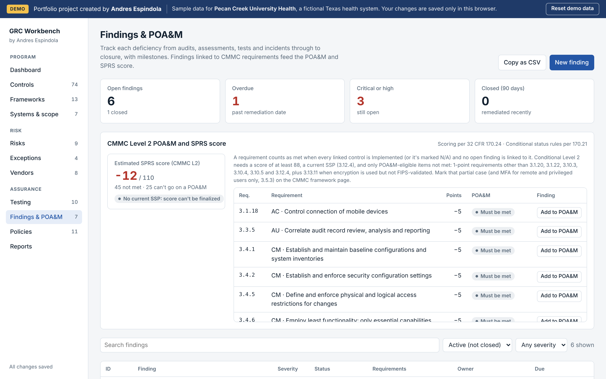
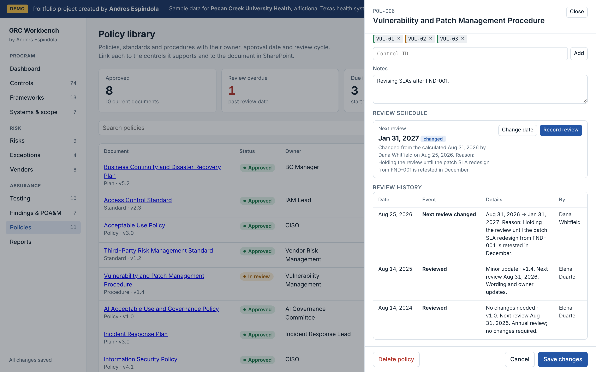
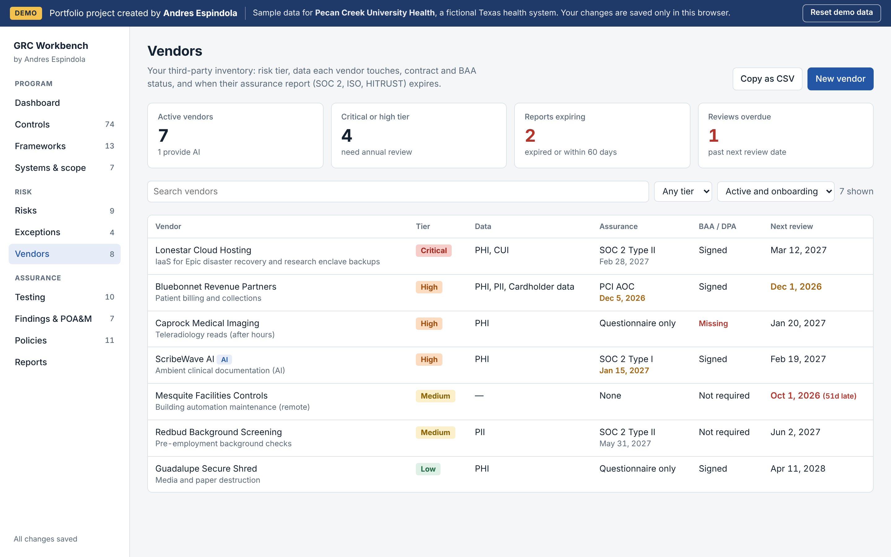

# GRC Control Workbench

*A portfolio project by **Andres Espindola**.*

A single-page governance, risk and compliance (GRC) application that maps one unified set of 74 security controls to 15 frameworks and regulations, so a control is tested once and counts toward every framework it satisfies.

**[Live demo](https://a-espindola.github.io/grc-control-workbench/)** · runs in your browser with fictional sample data

## Screenshots

| | |
| --- | --- |
|  **Dashboard:** framework readiness, SPRS score and action items |  **Frameworks:** categories, on/off switches and drag-to-reorder |
|  **Controls:** one control set mapped across every framework |  **Control mapping:** one MFA control satisfying requirements in 12 frameworks |
|  **Risk register:** residual heat map and score bands |  **Findings & POA&M:** CMMC Level 2 SPRS scoring |
|  **Policy library:** month-end review dates, reasons for date changes and review history |  **Third-party risk:** tiers, BAA status and assurance expiry |

## Why I built it

Organizations under several frameworks at once (HIPAA, CMMC, NIST CSF, state rules) often track each one in a separate spreadsheet, testing the same control over and over. This workbench keeps one control set with owners, evidence and test results, and maps each framework's requirements onto it. Readiness for every framework updates from the same control statuses.

## Features

- **Unified control mapping:** 74 controls across 19 domains mapped to framework requirements; add any framework and its requirements yourself.
- **Frameworks:** grouped by category, reordered by drag and drop, switched on or off; requirements can be marked N/A with a reason.
- **Dashboard:** readiness per framework, control status by domain and action items (overdue tests, findings, reviews, expiring exceptions).
- **CMMC Level 2 SPRS scoring:** point values and POA&M eligibility rules per 32 CFR 170.24 and 170.21.
- **Risk register:** likelihood × impact scoring, inherent and residual heat maps, and risks linked to the controls that treat them.
- **Findings and POA&M:** severity, milestones, due dates, and links to the requirements they affect.
- **Control testing:** design and operating-effectiveness results that prompt a finding when a control fails.
- **Third-party risk:** vendor tiers, BAA status, assurance report expiry and review dates.
- **Systems and scope:** in-scope systems with their data types and frameworks.
- **Policy library:** review dates set to the last day of the month, date changes that require a recorded reason, and a full review history.
- **Exceptions:** compensating controls, approver and expiry date.
- **Reports and CSV export** for every module.

## Frameworks included

| Category | Frameworks |
| --- | --- |
| Cybersecurity standards | NIST CSF 2.0, NIST SP 800-53 Rev. 5, CISA Cross-Sector Cybersecurity Performance Goals 2.0 |
| Healthcare | HIPAA Security Rule, proposed HIPAA Security Rule (NPRM, Jan 2025), HHS Healthcare Cybersecurity Performance Goals |
| Federal and defense | CMMC 2.0 Level 2, NIST SP 800-171 Rev. 3 |
| State regulation | Texas Cybersecurity Framework, TX-RAMP Level 1 |
| Financial services | SOX IT general controls (practitioner set), NYDFS 23 NYCRR 500 |
| AI governance | NIST AI RMF 1.0 |
| Privacy | NIST Privacy Framework 1.0 |
| Operational technology | NIST SP 800-82 |

Only frameworks published by government bodies or written for this project are included.

## Tech

- Vanilla JavaScript, HTML and CSS in one file, with no frameworks, libraries or build step.
- Charts and the heat map are drawn with HTML and CSS.
- The demo saves to the visitor's browser storage (`localStorage`); nothing is sent to a server. **Reset demo data** in the banner restores the sample.

## Run it locally

Download `index.html` and open it in a browser. That's all it needs.

## Publish it with GitHub Pages

1. Upload this folder's contents to a public repository named `grc-control-workbench`.
2. In the repository, go to **Settings → Pages**, set **Branch** to `main` and the folder to `/ (root)`, then click **Save**.
3. After a minute or two the demo is live at `https://YOUR-USERNAME.github.io/grc-control-workbench/`. Put that address in the live demo link at the top of this README.

## Sample data

The demo company, **Pecan Creek University Health**, is fictional. All people, systems, vendors, findings and links are invented, and the links point to a reserved `.example` domain that doesn't resolve.

## Disclaimer

Framework references and mappings are for demonstration and may be incomplete or out of date. Check requirements against the official source before relying on them. This project isn't legal or compliance advice.

All trademarks, product names and framework names mentioned in this project belong to their respective owners. Their use here doesn't imply endorsement or affiliation.

## Author

Designed and built by **Andres Espindola**, with AI-assisted development.
